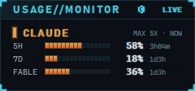
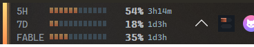
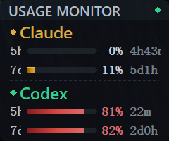
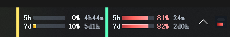

# Claude Codex Usage Monitor

[中文](#中文说明) | [English](#english)

## 中文说明

### 项目简介
`Claude Codex Usage Monitor` 是一个 Windows 与 Apple Silicon macOS 桌面实时用量监控工具，显示 Claude Code（5 小时 / 7 天 / Fable 周额度）、Codex 与 Cursor 的使用率和重置倒计时。

### v0.7.3 Win11 Bar 可见性修复预览

v0.7.3 修复 Win11 Bar 挂载后不可见的问题：Win11 改用任务栏内部独立合成窗口，Win10 保留子窗口嵌入；异常才回退上方摘要。新版本 Win11 实际效果待复测。Apple Silicon（M 系列）Mac / macOS 13+ 新增菜单栏与浮窗源码，构建入口：

```bash
bash scripts/build-macos.sh
```

当前在 Windows 10 完成 19 项测试、通信集成、Release 和 NSIS；Mac 私有 Apple Silicon CI 完成 13 项核心测试、Rust/Swift 编译、通信及 DMG 挂载/签名检查。v0.7.3 共享目录新增 `UsageMonitor-0.7.3-arm64-unsigned.dmg`，拖入 Applications 安装；此包使用 ad-hoc 签名、未公证且无自动更新，Win11 与 Mac 真机仍待验证。推荐版仍为 v0.6.2。见 `releases/0.7.3-macos.md`。详细步骤见源码包内 `_Documentation/PlatformSupport.md`。

Windows 托盘右键 →「软件更新」：自动检查并准备新版，点击「安装更新并重启」；支持稳定/预览通道，保留配置与旧程序备份。旧版需先手动升级一次 0.7.1。Mac 0.7.4 测试包已配置 Sparkle HTTPS 签名更新；0.7.3 需手动安装本版一次，之后可在程序内检查更新。安装包位于团队共享 `v0.7.4/UsageMonitor-0.7.4-arm64-unsigned-updates.dmg`，仅公开二进制与更新清单，源码保持私有；实际隔离副本下载/验签/替换已通过，仍未做 Apple 公证。见 `releases/0.7.4.md`；详见源码包 `_Documentation/AutoUpdate.md`。

### 界面截图

#### Neon HUD 主题（默认）
悬浮窗：



任务栏嵌入（AppBar）：



#### Classic 主题



### 主要特性
- 三通道监控：Claude、Codex、Cursor 可分别开关。
- Claude 额度窗口动态显示：5h、7d，以及按模型的周额度（例如 Fable）；启用了 Extra 用量时自动多一行。
- 两套主题：Neon HUD（8px 点阵、发光分段条、青色结构线）与 Classic，托盘菜单「主题」随时切换。
- 多展示模式：悬浮窗与任务栏嵌入（AppBar），列宽随 DPI 缩放。
- 状态感知：接口限流时保留上次数据并标注「as of Xm ago」；凭据失效时提示「打开一次 Claude Code 即可恢复」。
- 托盘交互：左键显示/隐藏，右键完整菜单；动态托盘图标显示双进度条。
- 自动刷新：Claude 接口轮询下限 120 秒，429 时指数退避到 15 分钟。

### 数据来源
- Claude：读取 `~/.claude/.credentials.json` 的 OAuth token，请求 `https://api.anthropic.com/api/oauth/usage`。token 过期或被拒时静默（无控制台窗口）拉起 Claude Code CLI，通过其 headless `get_usage` 控制请求刷新并回写凭证文件；本程序不接触 refresh token，不会影响 Claude Code 登录态。拉起是有界的：同一份凭证最多尝试 3 次（立即 / 5 分钟后 / 15 分钟后），用完即停并提示「打开一次 Claude Code」；凭证文件变化、托盘「立即刷新」或重启会重置计数。CLI 查找覆盖 PATH 上的 `claude.exe` / `claude.cmd`、npm 全局目录与 `~/.local/bin`。
- Codex：只读 app-server 查询额度与日 Tokens；按真实窗口动态显示，Pro 系列隐藏 5h。CLI 不可用时降级为 WHAM GET。
- Cursor：粘贴浏览器 Cookie 后读取个人套餐用量。

### 运行环境
- Windows 10/11
- 已登录的 Claude Code CLI（`claude`）；Codex / Cursor 可选

### 安装
从 [GitHub Releases](https://github.com/Sundogs-s/Claude-Codex-Usage-Monitor/releases) 下载 `UsageMonitor-<version>-Setup.exe` 运行即可；支持静默安装 `/S`。

### 本地构建
```bash
cargo build --release
.\target\release\usage-monitor.exe
```
打包安装程序需要 NSIS：运行 `build_installer.bat`。

### 诊断
- 日志：`%LOCALAPPDATA%\UsageMonitor\_runtime_logs\usage-monitor.log`（5 MB 轮转；`USAGE_MONITOR_DEBUG=1` 打开 Debug）。
- `usage-monitor.exe --probe` 直连一次额度接口；`--probe --cli` 走 Claude Code CLI 刷新路径。

### 技术栈
- Rust 2021，Windows API（`windows` crate，GDI 绘制）
- Tokio + Reqwest

---

## English

### Overview
`Claude Codex Usage Monitor` is a Windows desktop utility that shows real-time usage for Claude Code (5-hour / 7-day / per-model weekly windows such as Fable), Codex and Cursor, with reset countdowns.

### v0.7.3 Windows 11 Bar visibility fix preview

v0.7.3 uses an independent composited window inside the Windows 11 taskbar bounds; Windows 10 retains child-window embedding. This addresses the v0.7.2 invisible-Bar report; Windows 11 device retesting remains pending. Native menu-bar / floating-window source for Apple Silicon Macs (macOS 13+) is available. Run `bash scripts/build-macos.sh` on an M-series Mac with Xcode CLI tools and Rust installed.

Windows 10 tests (19), integration checks and packaging passed. Private Apple Silicon CI passed 13 core tests, Rust/Swift compilation, IPC and DMG mounting/signature checks. v0.7.3 now includes `UsageMonitor-0.7.3-arm64-unsigned.dmg` for manual testing: ad-hoc signed, not notarized, with automatic updates unconfigured. Windows 11 and Mac device checks remain pending. v0.6.2 remains the recommended team version. See `releases/0.7.3-macos.md`.

Windows now checks/prepares updates in the background; use the tray Software Update submenu to install and restart. Upgrade manually to 0.7.1 once to enable this. Stable and preview feeds are separate. Mac 0.7.4 test DMG enables signed HTTPS Sparkle feeds and updates. Install it manually once from 0.7.3. An isolated copy passed actual download, signature verification and replacement from the public binary-only release host; the app is still ad-hoc signed and not Apple notarized. See `releases/0.7.4.md`. See `_Documentation/AutoUpdate.md` in the source archive.

### Screenshots

#### Neon HUD theme (default)
Floating window:


Taskbar-embedded AppBar:


#### Classic theme


### Features
- Three channels — Claude, Codex, Cursor — each can be toggled.
- Dynamic Claude windows: 5h, 7d and per-model weekly limits (e.g. Fable); an Extra-usage row appears when enabled.
- Two themes: Neon HUD (8px pixel grid, glowing segmented bars, cyan structure) and Classic, switchable from the tray menu.
- Display modes: floating window and taskbar-embedded AppBar; column widths follow the DPI.
- State-aware: keeps last-known data with an "as of Xm ago" note while the usage API is rate-limited; tells you to open Claude Code once when credentials expire.
- Tray: left click to show/hide, right click for the full menu; dynamic tray icon with two progress bars.
- Polling floor of 120 s for the Claude usage API with exponential back-off (up to 15 min) on 429.

### Data sources
- Claude: OAuth token from `~/.claude/.credentials.json` against `https://api.anthropic.com/api/oauth/usage`. Expired or rejected tokens are refreshed by silently launching the Claude Code CLI (no console window) and asking it through its headless `get_usage` control request, which rewrites the credentials file; the monitor never touches the refresh token, so it cannot break your Claude Code login. Launches are bounded: at most 3 per credentials generation (now / +5 min / +15 min), then it stops and asks you to open Claude Code once; a changed credentials file, the tray "立即刷新" action, or a restart resets the counter. CLI lookup covers `claude.exe` / `claude.cmd` on PATH, the npm global directory and `~/.local/bin`.
- Codex: read-only app-server quota and daily-token queries, dynamic window labels, and no 5h row for Pro plans. Read-only WHAM fallback when the CLI is unavailable.
- Cursor: personal-plan usage via a pasted browser cookie.

### Requirements
- Windows 10/11
- A signed-in Claude Code CLI (`claude`); Codex / Cursor optional

### Install
Download `UsageMonitor-<version>-Setup.exe` from [GitHub Releases](https://github.com/Sundogs-s/Claude-Codex-Usage-Monitor/releases) and run it; `/S` installs silently.

### Build
```bash
cargo build --release
.\target\release\usage-monitor.exe
```
Packaging the installer needs NSIS: run `build_installer.bat`.

### Diagnostics
- Log: `%LOCALAPPDATA%\UsageMonitor\_runtime_logs\usage-monitor.log` (5 MB rotation; `USAGE_MONITOR_DEBUG=1` for Debug).
- `usage-monitor.exe --probe` hits the usage endpoint once; `--probe --cli` exercises the Claude Code CLI refresh path and reports which CLI was used and whether the credentials file was rewritten.

### Tech Stack
- Rust 2021, Windows API (`windows` crate, GDI rendering)
- Tokio + Reqwest

## 团队发布目录

安装包与便携版从 `N:\PROJECTS\AI\UsageMointor` 获取；无映射盘时打开 `\\qianwang\work\PROJECTS\AI\UsageMointor`。根目录 README 指向当前推荐版本。
Codex 统计查询不调用模型；服务端未返回今日数据时显示最近统计日期。右键「Codex 用量详情」可查看所有额度窗口、Credits、可用重置次数和最近日统计。
